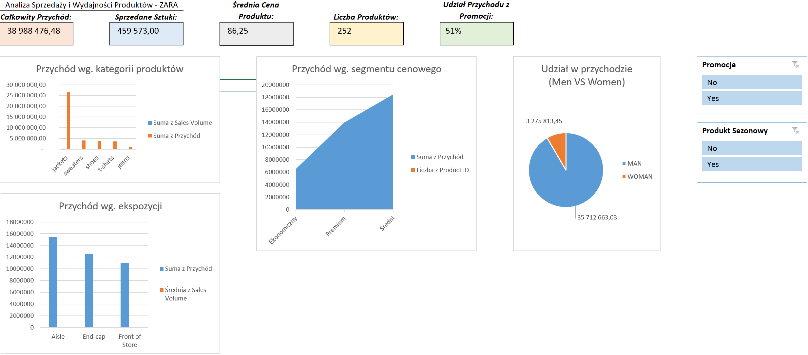

# Analiza Sprzedaży i Wydajności Produktów – ZARA

### O projekcie:
Interaktywny dashboard w Excelu analizujący strukturę przychodów, wolumen sprzedaży oraz czynniki wpływające na wyniki 252 produktów odzieżowych marki Zara.

### Zbiór danych:
Źródło: [Zara Sales Dataset (GitHub)](https://github.com/Mehdi-Benbiba/Zara-Sales-analysis/tree/main)

### Zakres analizy:
* Główne wskaźniki KPI: całkowity przychód, sprzedane sztuki, średnia cena, liczba produktów oraz udział sprzedaży promocyjnej
* Przychód według kategorii produktów (*Jackets*, *Sweaters*, *Shoes*, *T-shirts*, *Jeans*)
* Wyniki sprzedaży według ekspozycji w sklepie (*Aisle*, *End-cap*, *Front of Store*)
* Udział przychodów w podziale na działy (*MAN* vs *WOMAN*)
* Struktura przychodów według segmentów cenowych (*Ekonomiczny*, *Średni*, *Premium*)

### Narzędzia:
* Microsoft Excel (Tabele Przestawne, Wykresy Przestawne, Fragmentatory, Tabele Excela, funkcje `JEŻELI` / `SUMA.JEŻELI` / `ILE.LICZB`)

### Podgląd Dashboardu:

